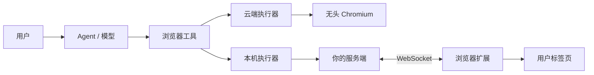
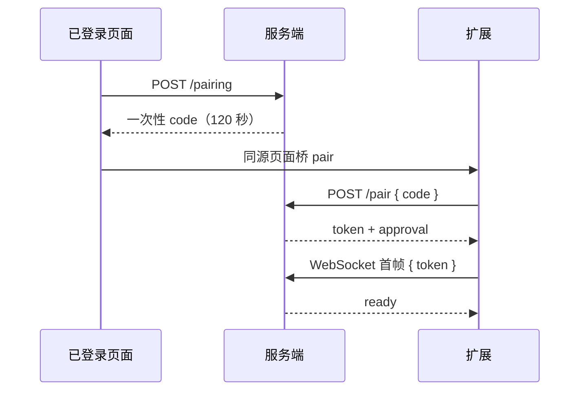
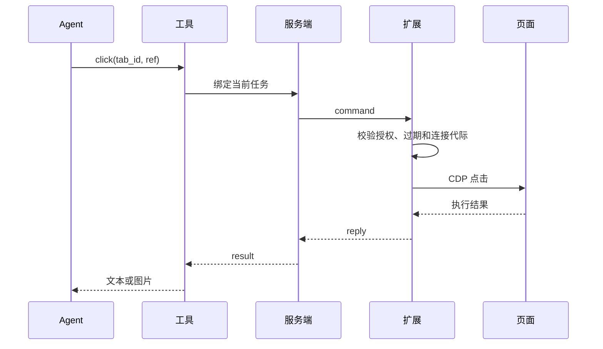

# 浏览器能力实现

给 Agent 加浏览器能力，通常只有两条路：

1. **云端托管浏览器**：在你的服务器上运行无头 Chromium，适合公开网页、渲染验证、截图和下载。
2. **本机浏览器扩展**：通过浏览器扩展操作用户自己的标签页，复用已有登录状态。

两条路共享“模型 → 工具 → 执行 → 结果”的框架，但不共享浏览器实例、凭据和标签页。同一个任务可以同时使用两者。

## 先选型

| 维度 | 云端托管浏览器 | 本机浏览器扩展 |
| --- | --- | --- |
| 运行位置 | 你的服务器或容器 | 用户电脑上的 Chrome / Edge |
| 适合 | 公开网页、抓取、截图、渲染检查 | 已登录的系统、用户当前打开的页面 |
| 登录态 | 独立上下文，不继承用户登录 | 复用页面已有状态，不需要导出 Cookie |
| 隔离方式 | 每个任务一个浏览器会话 | 每个标签页显式授权 |
| 主要成本 | 浏览器运行时与并发配额 | 扩展分发、配对和连接维护 |

选择规则：

- 用户明确指定本机、云端或某个页面时，先遵守用户选择。
- 公开网页优先云端。
- “我浏览器里登录的系统”“我已经打开的页面”使用本机。
- 本机未连接时引导用户安装或连接，**不要用没有登录态的云端浏览器悄悄替代**。

## 总体架构



三条贯穿始终的原则：

- 模型只看到少量工具，不直接接触 CDP。
- 每次调用由服务端补全任务身份，模型不能自己指定 owner 或 turn。
- 授权、取消和超时由代码执行，不靠提示词约束。

## 云端托管浏览器

### 命令入口

对外只暴露一个固定命令，例如：

```sh
browser open https://example.com
browser snapshot
browser screenshot --filename=page.png
browser close
```

包装器负责固定会话、配置和输出目录。不要让模型直接调用裸 `chromium` 或通用 Playwright 命令，否则会话和文件会失控。

### 会话隔离

- 会话名使用任务 ID，例如 `task-<conversation_id>`。
- 每个会话有独立的状态、缓存和输出目录。
- 同一会话加跨进程命令锁，避免并发操作。
- 用户级并发配额，例如最多 2 个活动会话；只有 `open` 领取配额，后续命令复用。
- `close`、空闲回收或运行时关闭时释放配额并清理进程。

### 浏览器配置

```json
{
  "browser": "chromium",
  "headless": true,
  "isolated": true,
  "actionTimeoutMs": 10000,
  "navigationTimeoutMs": 60000,
  "outputMode": "stdout",
  "allowUnrestrictedFileAccess": false
}
```

- 使用完整 Chromium，而不是精简的 headless-shell。
- `--filename` 等输出参数只接受普通文件名，统一写入受管目录。
- 容器内仍需限制根文件系统、权限和资源；关闭 Chromium 沙箱时，不能声称存在浏览器级沙箱。

### 只读模式

给 Plan 或只读任务单独提供入口：

- 命令白名单：导航、快照、查找、截图、PDF、滚动、hover、标签管理。
- 拒绝 click、任意脚本、上传和存储修改。
- 网络层只放行 `GET` / `HEAD` / `OPTIONS`，关闭下载和 WebSocket。
- 限制参数数量、单参数长度、总长度和超时。
- 命令串行执行，取消立即生效。

“只读”是命令和请求方法约束，不是绝对无副作用：网页 JavaScript 仍会执行，第三方 `GET` 也可能改变状态。

### 生命周期

```text
open → 领取配额 → 复用
  turn 结束 → 保留浏览器
  close / 空闲超时 / 运行时关闭 → 清理
```

清理时先尝试正常关闭；失败再按会话名结束残留进程，最后删除租约和临时目录。保留任务已经产出的文件。

## 本机浏览器扩展

### 扩展组成

| 文件 | 作用 |
| --- | --- |
| `background` | 配对、WebSocket、命令队列、CDP 执行、取消 |
| `content` | 网页与扩展之间的消息桥 |
| `popup` | 确认连接、共享当前页、停止共享、断开 |
| `control` | 被控页面上的描边和虚拟指针 |

使用 Manifest V3，权限保持最小：`debugger`、`storage`、`activeTab`、`scripting`。

Host permissions 覆盖较宽，不代表已经授权；真正的边界在标签页授权记录。

### 配对



要点：

- code 使用随机值，短有效期，只能消费一次。
- token 通过 WebSocket 首帧发送，不放在 URL 或日志里。
- 持久 approval 支持自动续接；用户撤销后立即失效。
- 配对码交换按来源 IP 限流。

### 标签页授权

```json
{
  "tab_id": 123,
  "conversation_id": null
}
```

- `conversation_id: null` 表示用户已共享，但还没有任务认领。
- 任务第一次实际操作时认领；其他任务不能操作，直到原任务 `release` 或用户重新授权。
- `release` 只解除认领，不停止共享、不关闭页面。
- **授权粒度是标签页，不是域名。** 同一标签页在网站之间跳转，不会每次重新确认。

### 命令协议

请求：

```json
{
  "id": "<command-uuid>",
  "connection_id": "<connection-uuid>",
  "conversation_id": "<conversation-uuid>",
  "expires_at": 0,
  "request": { "action": "snapshot", "tab_id": 123 }
}
```

响应：

```json
{
  "id": "<command-uuid>",
  "result": { "ok": true, "data": { "tab_id": 123, "elements": [] } }
}
```

取消：

```json
{ "type": "cancel", "id": "<command-uuid>" }
```

- 每条命令带过期时间，例如 30 秒。
- 服务端用连接 ID 作为 fence，旧连接的回包不能生效。
- 单次投递、不自动重放。回包丢失时，先重新观察页面，不要盲目再提交。

### 动作集

| action | 说明 | 只读 |
| --- | --- | --- |
| `status` | 连接状态 | 是 |
| `tabs` | 当前任务可用的标签页 | 是 |
| `open` | 新建标签页并认领 | 否 |
| `navigate` | 导航 | 否 |
| `snapshot` | 无障碍树快照 | 是 |
| `screenshot` | JPEG 与 viewport 尺寸 | 是 |
| `click` / `click_at` | 按引用或坐标点击 | 否 |
| `type` | 向已聚焦元素输入 | 否 |
| `scroll` | 滚轮 | 否 |
| `key` | 受限按键 | 否 |
| `release` | 解除任务认领 | 否 |

不要提供任意 `evaluate`、Cookie 读取、本机文件上传或桌面控制。

### 快照与引用

引用格式：

```text
<document-loader-id>:<backend-node-id>
```

生成步骤：

1. 用 `Page.getFrameTree` 取得当前文档的 `loaderId`。
2. 用 `Accessibility.getFullAXTree` 取得无障碍树。
3. 排除扩展自己的控制提示子树。
4. 过滤不可见、没有名称、没有 DOM 节点的元素。
5. 最多返回 200 个元素，每个包含 `ref`、`role`、`name`。

点击前校验 loader ID 仍属于当前文档。导航后旧引用立即失效，必须重新快照。

### 连接与重连

- 扩展每 20 秒发送心跳；超过 45 秒未收到判定失联。
- 断线后指数退避重连，例如 1 / 2 / 4 / 8 / 16 / 30 秒，最多 6 次。
- `4401` 表示需要重新认证，`4403` 表示被拒绝，`4408` 表示心跳超时。
- **重连只恢复传输，不重放旧操作。**

## 一次本机调用的完整链路



服务端只允许当前任务 token 对应的活动 turn 调用工具。参数里不包含 owner、connection、conversation 或 turn，这些身份由服务端补全。

## 安全边界

1. 工具必须绑定真实的 owner、conversation 和 running turn。
2. 页面必须由用户授权，且不能属于其他任务。
3. 执行前、调试器连接后和每个关键步骤前，重新检查授权、取消和截止时间。
4. 页面内容是不可信数据，不能当成系统指令；这是降低提示注入风险，不是消除。
5. 传输使用 HTTPS / WSS；token 不进入日志、URL 或前端状态。
6. 安装、连接和共享都不等于批准所有敏感操作。高风险动作需要产品层确认。

## 失败语义

| 错误 | 含义 | 处理 |
| --- | --- | --- |
| `NOT_CONNECTED` | 没有有效连接 | 检查扩展、配对账号和连接状态 |
| `BUSY` | 上一条命令还未结束 | 先确认结果，不盲目重放 |
| `ACCESS_DENIED` | 任务、模式或页面授权不满足 | 分层核对权限，必要时重新授权 |
| `TAB_BUSY` | 页面已被其他任务认领 | 原任务 `release`，或用户重新共享 |
| `STALE_REF` | 引用不属于当前文档或节点已失效 | 重新快照 |
| `TIMEOUT` | 超过命令截止时间 | 先观察页面实际结果 |
| `CANCELLED` | 取消、撤权、断线或旧连接失效 | 不自动续做原动作 |

统一返回结构：

```ts
type BrowserResult<T> =
  | { ok: true; data: T }
  | { ok: false; code: string; message: string; retryable: false };
```

不要用“多点几次提交”“自动换云端”或“重建任务”掩盖授权和不确定副作用问题。

## 最小实现路线

1. 定义工具 schema、动作集和统一结果格式。
2. 云端：写命令包装器，固定会话、配置和输出目录。
3. 本机：做一个 Manifest V3 扩展和一次性配对码。
4. 服务端：建立 WebSocket 转发和标签页授权记录。
5. 先实现 `status`、`tabs`、`snapshot`、`click`、`type` 五个动作。
6. 加取消、超时、连接代际校验和错误码。
7. 加只读模式和命令白名单。
8. 用真实页面验证导航后引用失效、断线重连和并发占用。

:::tip
先只做读取（`snapshot` / `screenshot`），确认授权、观察和结果回传都正确，再加入第一个写动作 `click`。
:::

## 参考实现

本文抽象自 LinkSense 的 Browser Use 实现，可作为完整参考：

- 源码：<https://github.com/LingX-AI/LinkSense>
- 架构文档：[browser-use-implementation.md](https://github.com/LingX-AI/LinkSense/blob/e6be5d5/docs/development/browser-use-implementation.md)
