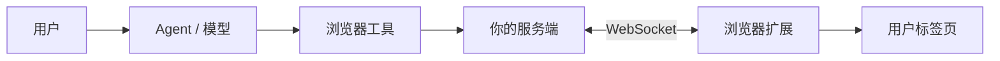
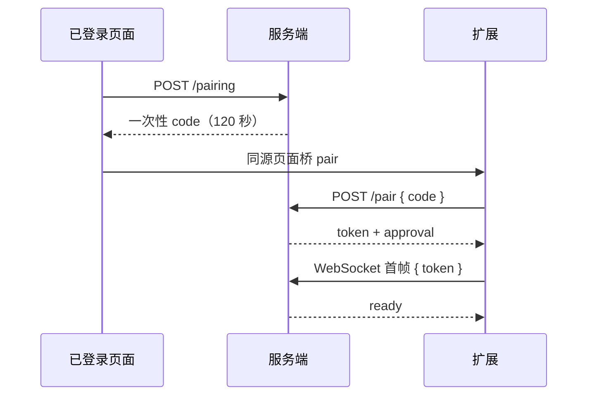
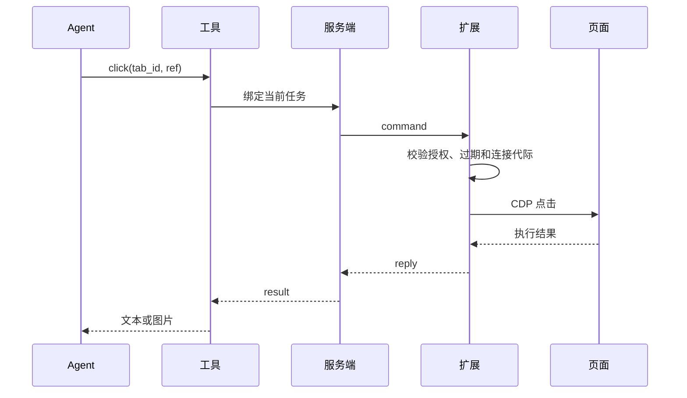

# Browser Use

Browser Use 指让 Agent 操作用户真实浏览器标签页的能力。实现方式是给浏览器安装扩展：用户明确共享页面，Agent 通过服务端下发命令，扩展在授权标签页上执行 CDP 操作，从而复用页面已有的登录状态。

适合：

- 用户已经登录的系统。
- 用户当前打开的页面。
- 不希望导出 Cookie 或重建登录态的场景。

如果只需要读取公开网页，普通的 HTTP 请求或服务端无头浏览器更简单，不需要扩展。

## 总体架构



三条贯穿始终的原则：

- 模型只看到少量工具，不直接接触 CDP。
- 每次调用由服务端补全任务身份，模型不能自己指定 owner 或 turn。
- 授权、取消和超时由代码执行，不靠提示词约束。

## 技术栈

| 层 | 选择 | 用途 |
| --- | --- | --- |
| 浏览器扩展 | Manifest V3 + TypeScript | 权限声明、Service Worker、内容脚本 |
| 调试协议 | Chrome DevTools Protocol（`chrome.debugger`） | 快照、点击、输入 |
| 打包 | esbuild，target `chrome127` | 把 TypeScript 打成可直接加载的扩展 |
| 服务端 | Node.js + Hono（或任意 WebSocket 服务） | 配对、鉴权、命令转发 |
| 共享校验 | Zod | 请求和回包的运行时校验 |
| 状态（可选） | Redis | 跨实例的连接、锁和短期命令 |
| Agent 工具 | `ai` 的 `tool()` | 把动作暴露给模型 |

分工：

- 扩展只执行，不做决策。
- 服务端不碰 CDP，只做鉴权和转发。
- 协议共享一份 Zod schema，前后端类型同源。

## 扩展组成

| 文件 | 作用 |
| --- | --- |
| `background` | 配对、WebSocket、命令队列、CDP 执行、取消 |
| `content` | 网页与扩展之间的消息桥 |
| `popup` | 确认连接、共享当前页、停止共享、断开 |
| `control` | 被控页面上的描边和虚拟指针 |

使用 Manifest V3，权限保持最小：`debugger`、`storage`、`activeTab`、`scripting`。

Host permissions 覆盖较宽，不代表已经授权；真正的边界在标签页授权记录。

## 配对



要点：

- code 使用随机值，短有效期，只能消费一次。
- token 通过 WebSocket 首帧发送，不放在 URL 或日志里。
- 持久 approval 支持自动续接；用户撤销后立即失效。
- 配对码交换按来源 IP 限流。

## 标签页授权

```json
{
  "tab_id": 123,
  "conversation_id": null
}
```

- `conversation_id: null` 表示用户已共享，但还没有任务认领。
- 任务第一次实际操作时认领；其他任务不能操作，直到原任务 `release` 或用户重新授权。
- `release` 只解除认领，不停止共享、不关闭页面。
- **授权粒度是标签页，不是域名。** 同一标签页在网站之间跳转，不会每次重新确认。

## 命令协议

请求：

```json
{
  "id": "<command-uuid>",
  "connection_id": "<connection-uuid>",
  "conversation_id": "<conversation-uuid>",
  "expires_at": 0,
  "request": { "action": "snapshot", "tab_id": 123 }
}
```

响应：

```json
{
  "id": "<command-uuid>",
  "result": { "ok": true, "data": { "tab_id": 123, "elements": [] } }
}
```

取消：

```json
{ "type": "cancel", "id": "<command-uuid>" }
```

- 每条命令带过期时间，例如 30 秒。
- 服务端用连接 ID 作为 fence，旧连接的回包不能生效。
- 单次投递、不自动重放。回包丢失时，先重新观察页面，不要盲目再提交。

## 动作集

| action | 说明 | 只读 |
| --- | --- | --- |
| `status` | 连接状态 | 是 |
| `tabs` | 当前任务可用的标签页 | 是 |
| `open` | 新建标签页并认领 | 否 |
| `navigate` | 导航 | 否 |
| `snapshot` | 无障碍树快照 | 是 |
| `screenshot` | JPEG 与 viewport 尺寸 | 是 |
| `click` / `click_at` | 按引用或坐标点击 | 否 |
| `type` | 向已聚焦元素输入 | 否 |
| `scroll` | 滚轮 | 否 |
| `key` | 受限按键 | 否 |
| `release` | 解除任务认领 | 否 |

只读任务（例如 Plan 模式）只开放 `status`、`tabs`、`snapshot`、`screenshot`。

不要提供任意 `evaluate`、Cookie 读取、本机文件上传或桌面控制。

## 快照与引用

引用格式：

```text
<document-loader-id>:<backend-node-id>
```

生成步骤：

1. 用 `Page.getFrameTree` 取得当前文档的 `loaderId`。
2. 用 `Accessibility.getFullAXTree` 取得无障碍树。
3. 排除扩展自己的控制提示子树。
4. 过滤不可见、没有名称、没有 DOM 节点的元素。
5. 最多返回 200 个元素，每个包含 `ref`、`role`、`name`。

点击前校验 loader ID 仍属于当前文档。导航后旧引用立即失效，必须重新快照。

## 连接与重连

- 扩展每 20 秒发送心跳；超过 45 秒未收到判定失联。
- 断线后指数退避重连，例如 1 / 2 / 4 / 8 / 16 / 30 秒，最多 6 次。
- `4401` 表示需要重新认证，`4403` 表示被拒绝，`4408` 表示心跳超时。
- **重连只恢复传输，不重放旧操作。**

## 一次调用的完整链路



服务端只允许当前任务 token 对应的活动 turn 调用工具。参数里不包含 owner、connection、conversation 或 turn，这些身份由服务端补全。

## 安全边界

1. 工具必须绑定真实的 owner、conversation 和 running turn。
2. 页面必须由用户授权，且不能属于其他任务。
3. 执行前、调试器连接后和每个关键步骤前，重新检查授权、取消和截止时间。
4. 页面内容是不可信数据，不能当成系统指令；这是降低提示注入风险，不是消除。
5. 传输使用 HTTPS / WSS；token 不进入日志、URL 或前端状态。
6. 安装、连接和共享都不等于批准所有敏感操作。高风险动作需要产品层确认。

## 失败语义

| 错误 | 含义 | 处理 |
| --- | --- | --- |
| `NOT_CONNECTED` | 没有有效连接 | 检查扩展、配对账号和连接状态 |
| `BUSY` | 上一条命令还未结束 | 先确认结果，不盲目重放 |
| `ACCESS_DENIED` | 任务、模式或页面授权不满足 | 分层核对权限，必要时重新授权 |
| `TAB_BUSY` | 页面已被其他任务认领 | 原任务 `release`，或用户重新共享 |
| `STALE_REF` | 引用不属于当前文档或节点已失效 | 重新快照 |
| `TIMEOUT` | 超过命令截止时间 | 先观察页面实际结果 |
| `CANCELLED` | 取消、撤权、断线或旧连接失效 | 不自动续做原动作 |

统一返回结构：

```ts
type BrowserResult<T> =
  | { ok: true; data: T }
  | { ok: false; code: string; message: string; retryable: false };
```

不要用“多点几次提交”“自动换执行端”或“重建任务”掩盖授权和不确定副作用问题。

## 最小实现

下面是最小可运行骨架，省略配对、鉴权和重连。完整流程见前文各节。

### 1. 共享协议

```ts
// shared/browser.ts
import { z } from 'zod';

export const browserCommandSchema = z.discriminatedUnion('action', [
  z.object({ action: z.literal('status') }),
  z.object({ action: z.literal('tabs') }),
  z.object({ action: z.literal('snapshot'), tab_id: z.number().int() }),
  z.object({ action: z.literal('click'), tab_id: z.number().int(), ref: z.string().max(200) }),
  z.object({ action: z.literal('type'), tab_id: z.number().int(), text: z.string().max(8000) }),
]);

export type BrowserCommand = z.infer<typeof browserCommandSchema>;
```

### 2. Manifest

```json
{
  "manifest_version": 3,
  "name": "Browser Use Bridge",
  "version": "0.1.0",
  "minimum_chrome_version": "127",
  "permissions": ["debugger", "storage", "activeTab", "scripting"],
  "host_permissions": ["https://*/*", "http://*/*"],
  "background": { "service_worker": "background.js", "type": "module" },
  "action": { "default_popup": "popup.html" }
}
```

`host_permissions` 只是声明能力，实际能操作哪些页面由标签页授权决定。

### 3. 扩展后台

```ts
// background.ts
let socket: WebSocket | undefined;

function connect(token: string) {
  socket = new WebSocket('wss://example.com/api/browser/socket');

  socket.onopen = () => socket?.send(JSON.stringify({ token }));

  socket.onmessage = async (event) => {
    const message = JSON.parse(event.data);
    if (message.type !== 'command') return;

    const result = await execute(message.request);
    socket?.send(JSON.stringify({ id: message.id, result }));
  };
}

async function execute(command: BrowserCommand) {
  if (command.action === 'status') return { ok: true, data: { connected: true } };

  if (command.action === 'tabs') {
    const tabs = await chrome.tabs.query({});
    return { ok: true, data: tabs.map(({ id, title, url }) => ({ id, title, url })) };
  }

  if (command.action === 'snapshot') {
    return { ok: true, data: await snapshot(command.tab_id) };
  }

  if (command.action === 'click') {
    await click(command.tab_id, command.ref);
    return { ok: true, data: { clicked: true } };
  }

  return { ok: false, code: 'UNSUPPORTED' };
}
```

### 4. 快照与点击

```ts
async function attach(tabId: number) {
  try {
    await chrome.debugger.attach({ tabId }, '1.3');
  } catch {
    // 已经连接
  }
}

async function snapshot(tabId: number) {
  await attach(tabId);

  const { frameTree } = await chrome.debugger.sendCommand({ tabId }, 'Page.getFrameTree');
  const { nodes } = await chrome.debugger.sendCommand({ tabId }, 'Accessibility.getFullAXTree');

  return {
    elements: nodes
      .filter((node: any) => node.backendDOMNodeId && node.name?.value)
      .slice(0, 200)
      .map((node: any) => ({
        ref: `${frameTree.frame.loaderId}:${node.backendDOMNodeId}`,
        role: node.role?.value,
        name: node.name?.value,
      })),
  };
}

async function click(tabId: number, ref: string) {
  await attach(tabId);

  const [loaderId, nodeId] = ref.split(':');
  const { frameTree } = await chrome.debugger.sendCommand({ tabId }, 'Page.getFrameTree');
  if (frameTree.frame.loaderId !== loaderId) throw new Error('STALE_REF');

  const { model } = await chrome.debugger.sendCommand({ tabId }, 'DOM.getBoxModel', {
    backendNodeId: Number(nodeId),
  });
  const x = (model.content[0] + model.content[2]) / 2;
  const y = (model.content[1] + model.content[5]) / 2;

  for (const type of ['mousePressed', 'mouseReleased'] as const) {
    await chrome.debugger.sendCommand({ tabId }, 'Input.dispatchMouseEvent', {
      type,
      x,
      y,
      button: 'left',
      clickCount: 1,
    });
  }
}
```

### 5. 服务端工具与命令转发

```ts
// server/browser-tool.ts
import { tool } from 'ai';
import { z } from 'zod';

export const browserTool = tool({
  description: '读取或操作已授权的浏览器标签页。先 status，再 tabs。',
  inputSchema: z.object({
    action: z.enum(['status', 'tabs', 'snapshot', 'click', 'type']),
    tab_id: z.number().int().optional(),
    ref: z.string().max(200).optional(),
    text: z.string().max(8000).optional(),
  }),
  execute: async (input) => {
    // 实际实现：按当前任务查出该用户的扩展连接
    return sendToExtension(input);
  },
});

let connection: WebSocket; // WebSocket 握手成功后赋值
const pending = new Map<string, (result: unknown) => void>();

function sendToExtension(request: BrowserCommand) {
  const id = crypto.randomUUID();

  return new Promise((resolve, reject) => {
    const timer = setTimeout(() => {
      pending.delete(id);
      reject(new Error('TIMEOUT'));
    }, 30_000);

    pending.set(id, (result) => {
      clearTimeout(timer);
      resolve(result);
    });

    connection.send(JSON.stringify({ type: 'command', id, request }));
  });
}

// WebSocket 收到扩展回包时
function onReply(message: { id: string; result: unknown }) {
  pending.get(message.id)?.(message.result);
  pending.delete(message.id);
}
```

### 落地顺序

1. 定义协议和统一结果格式。
2. 做一个 Manifest V3 扩展和一次性配对码。
3. 服务端建立 WebSocket 转发和标签页授权记录。
4. 先实现 `status`、`tabs`、`snapshot`、`click`、`type`。
5. 加取消、超时、连接代际校验和错误码。
6. 为只读任务限制动作集。
7. 用真实页面验证导航后引用失效、断线重连和并发占用。

:::tip
先只做读取（`snapshot` / `screenshot`），确认授权、观察和结果回传都正确，再加入第一个写动作 `click`。
:::

## 参考实现

本文抽象自 LinkSense 的浏览器扩展实现，可作为完整参考：

- 源码：<https://github.com/LingX-AI/LinkSense>
- 架构文档：[browser-use-implementation.md](https://github.com/LingX-AI/LinkSense/blob/e6be5d5/docs/development/browser-use-implementation.md)
